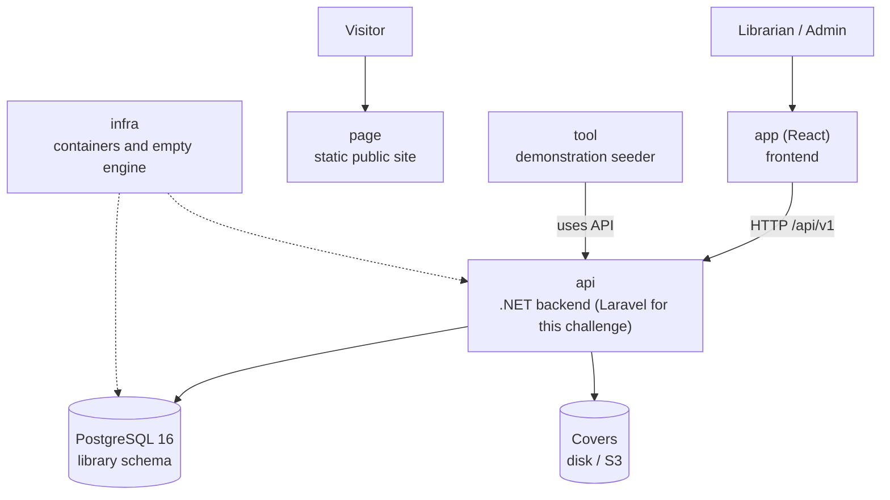

# Architecture at a Glance — Manager Library

Read this in five minutes before opening the rest. Details are in [`architecture.md`](architecture.md).

## The system at a glance

## The six repositories and their roles

| Repo | Role | Tested by |
|---|---|---|
| `docs` | The specification | Whether this overview is sufficient to build the system |
| `api` | Business rules and HTTP contract | Domain, application, contract, and concurrency tests |
| `app` | Operational screens | An end-to-end flow: login → lend → return → report |
| `page` | Public presentation, with no API calls | Whether it looks good on mobile and desktop |
| `infra` | `docker compose up` and the empty database | Whether it starts with one command |
| `tool` | Demonstration data (books, members, loans) | Whether the presentation fair has real data |

## The five ideas that underpin the design

1. **A loan is an immutable fact**; only an item's `returned_at` changes.
2. **Copies are deducted and returned within the same operation** that creates or closes the item.
3. **Status is calculated**: `open`, `overdue`, or `closed` are not stored in the database.
4. **Frozen values do not follow the catalog**: the October report does not change because a book is renamed in November.
5. **The database is the last line of defense**: if the copies `CHECK` fails, something wrote outside the system.
