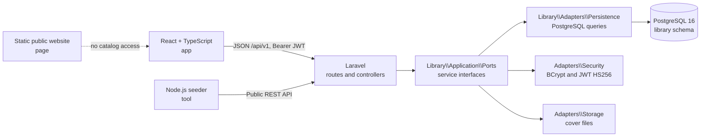

# Manager Library Architecture (Laravel)

The implementation consists of a modular Laravel API, a React client, and a PostgreSQL database. HTTP behavior follows [`../spec-.net/api-contract.md`](../spec-.net/api-contract.md); non-literal adaptations are documented in [`../implementation-decisions.md`](../implementation-decisions.md).

## Stack and local deployment

| Component | Selected technology |
|---|---|
| API | PHP 8.2+, Laravel 12 |
| Administrative client | React 19, TypeScript 5.8, Vite 6 |
| Database | PostgreSQL 16 |
| Local containers | Docker Compose |
| Public website | Static HTML/CSS served by Nginx |

The six projects remain in separate repositories. `infra/compose.yaml` builds the API, app, page, and seeder, and runs PostgreSQL on an internal network. The database has no business tables until `php artisan migrate --force` is explicitly run.

## API modules and dependencies



At the root of `test-manager-library-3145555-api/`:

```text
app/
├── Http/Controllers/       # HTTP adapters and request validation
├── Http/Middleware/        # JWT authentication and role authorization
├── Providers/              # Port/adapter bindings and initial provisioning
├── Support/                # Common API error representation
└── Console/Commands/       # Explicit administrator provisioning
src/Library/
├── Application/Ports/      # Repository, clock, token, hash, and cover interfaces
└── Adapters/               # Persistence, security, storage, and clock
database/migrations/        # PostgreSQL schema and initial categories
routes/api.php              # HTTP contract under /api/v1
```

The API enforces business rules while validating requests and in persistence adapters; the application user never accesses PostgreSQL directly. The current implementation follows ports and adapters but does not claim to have a separate `Domain/` layer that is not present in the repository.

## Persistence and concurrency

The initial migration creates six business tables in the PostgreSQL `library` schema: `category`, `user`, `book`, `member`, `loan`, and `loan_item`. It defines keys, constraints, and indexes and inserts the five product categories.

When creating a loan, Laravel validates and updates copy counts within a transaction, locks book rows, and uses a conditional update of available copies. When returning a copy, it updates the loan item and restores one available copy in the same transaction. The title, ISBN, and category on each loan item are snapshots that preserve historical information.

No version column is added because it is absent from the data model. The discrepancy with ADR-002 is documented in [`../implementation-decisions.md`](../implementation-decisions.md).

## Security and errors

- JWT HS256 expires after eight hours; `sub` and role are used for authorization.
- Passwords use BCrypt. `JWT_SECRET`, the initial administrator password, and other credentials come only from the environment.
- Routes are protected by authentication and role middleware (`admin` or `librarian`).
- CORS is restricted to the configured origin.
- JPG/PNG covers are validated by content and limited to 2 MB; React retrieves them through an authenticated request.
- REST errors use `code`, `message`, and `details`; stack traces and connection data are not sent to clients.

## Client scope

The React app provides sign-in, catalog, members, loans, returns, overdue tracking, reports, and librarian creation according to roles. The `page` website is independent and does not consume the operational catalog. The `tool` seeder uses REST routes and credentials supplied through the environment.
