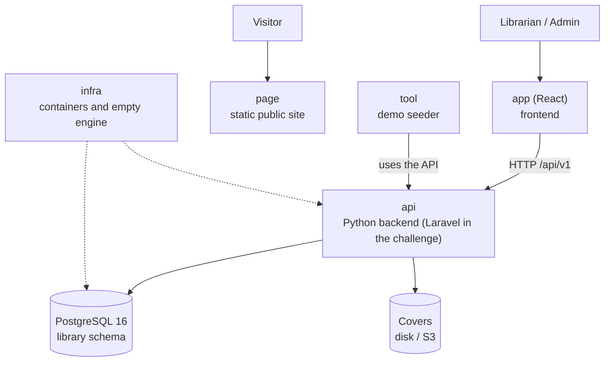

# One-page Architecture Overview — Manager Library

Read this in five minutes before opening the rest. Details are in [`architecture.md`](architecture.md).

## The system at a glance

## The six repositories and their roles

| Repo | Role | Verified by |
|---|---|---|
| `docs` | The specification | This overview is sufficient to build from |
| `api` | Business rules and HTTP contract | Domain, application, contract, and concurrency tests |
| `app` | Operations screens | End-to-end walkthrough: sign in → loan → return → report |
| `page` | Public presentation, without calling the API | Looks good on mobile and desktop |
| `infra` | `docker compose up` and the empty database | Starts with one command |
| `tool` | Demo data (books, members, loans) | The presentation fair has real data |

## The five ideas behind the design

1. **A loan is an immutable fact**; only an item's `returned_at` changes.
2. **Copies are decremented and returned in the same operation** that creates or closes the item.
3. **Status is calculated**: `open`, `overdue`, or `closed` are not stored in the database.
4. **Snapshots do not follow the catalog**: October's report does not change because a book is renamed in November.
5. **The database is the final safeguard**: if the copies `CHECK` fires, something wrote outside the system.
