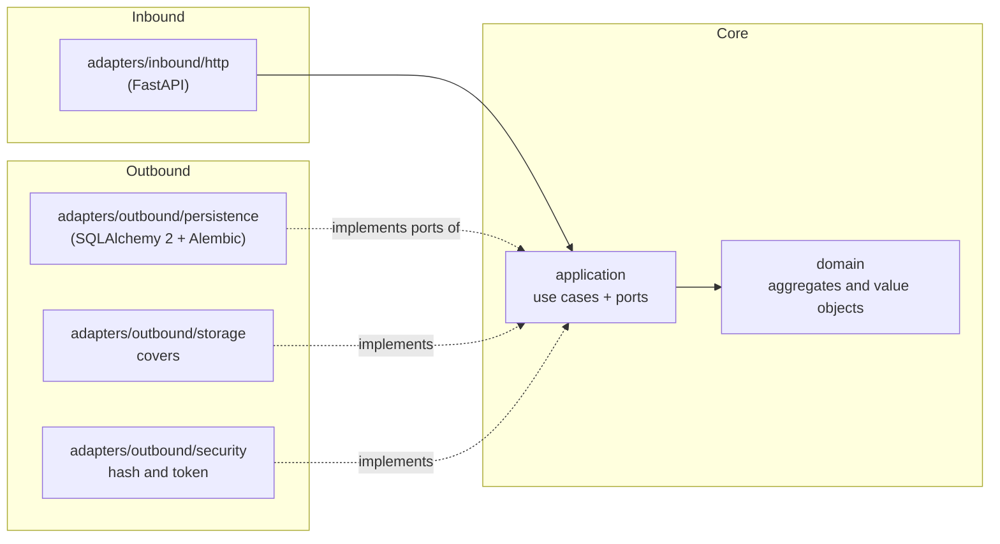
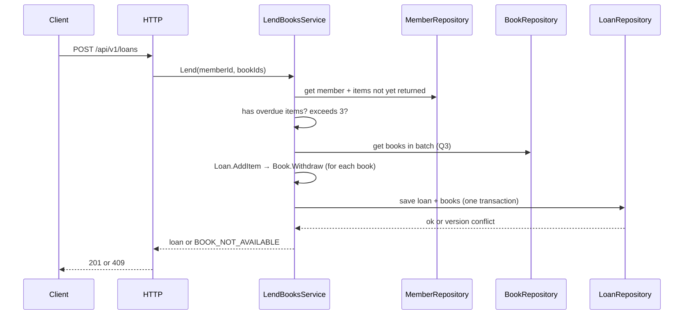

# Architecture — Manager Library (Python)

**Hexagonal architecture** (ports and adapters). Dependency rules are Articles I through III of [`constitution.md`](constitution.md).

## 1. Layers and dependencies



Dependency arrows point **inward**. `bootstrap` is the only layer that sees both sides.

## 2. Folder structure

```text
src/library/
├── domain/              # Book, Loan, LoanItem, Member, User; Isbn, Quantity, DateRange
├── application/
│   ├── ports/outbound/  # BookRepository, LoanRepository, MemberRepository, UserRepository,
│   │                    # ReportReader, Clock, PasswordHasher, TokenIssuer, CoverStorage
│   └── services/        # LendBooksService, ReturnItemService, CreateBookService, SearchBooksService,
│                        # OverdueService, MostBorrowedReportService, LoginService, CreateLibrarianService
├── adapters/
│   ├── inbound/http/    # routers/controllers, request schemas, error handling
│   └── outbound/        # persistence/, storage/, security/
└── bootstrap/composition/   # src/library/bootstrap/composition/port_bindings.py — single composition point
```

## 3. Aggregates

| Root | Contains | Invariants it protects |
|---|---|---|
| `Book` | `Isbn`, total and available copies, soft-delete state | Available copies between 0 and total; total ≥ 1; non-empty title |
| `Loan` | Collection of `LoanItem` | 1 to 3 items; no duplicate book; due in 14 days; immutable except for returns |
| `Member` | Document number | Required and unique document number |
| `User` | Role, hash | Normalized username; role in (`admin`, `librarian`) |

`Loan.AddItem` calls `Book.Withdraw` before adding the item: decrementing the copy and creating the item are **one operation**.
`Loan.ReturnItem` calls `Book.Restock` exactly once per item.

## 4. Flow: record a loan



## 5. Errors

The domain and application raise their own errors (`BookNotAvailable`, `MemberHasOverdue`, `MemberLimitExceeded`, …). **Only** the HTTP adapter
translates them into the single body and status code in [`api-contract.md`](api-contract.md). A framework error never reaches the client.

## 6. What is not included

No events, queues, cache, microservices, or multi-tenancy. Add them only if a requirement calls for them.
